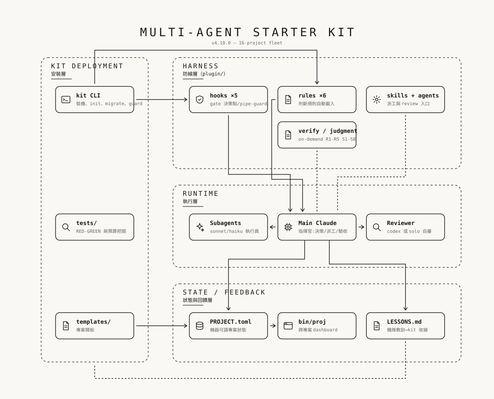

# Multi-Agent Starter Kit

[English](README.md) | **繁體中文**

你用 Claude Code 搭配 Superpowers 和 Codex plugin，結果自己變成在它們之間轉貼訊息的人肉路由器。這套 kit 每台機器只要裝一次，就能讓三個 agent 各守其位：每個改動都由另一個模型審查，還有一道 git guard 把私人資料擋在你的 commit 之外。



- **一次安裝**：每台機器只裝一個 Claude Code plugin；專案裡只放 `AGENTS.md` 和 `kit.toml`。
- **跨模型審查**：Stop gate 會把這一輪擋住，直到另一個模型審查過這批改動。
- **實體護欄**：hooks 會擋下高風險的編輯、失控的重試，以及會把失敗測試藏起來的 verifier 管線。
- **防洩漏**：這台機器上的每一次 `git commit` 和 `git push` 都會被掃描，檢查有沒有密鑰、本機路徑和你的個人字串。

需要 Claude Code、git、Python 3.11 以上，以及（跨模型審查用的）Codex CLI。

## 它怎麼運作

```
你 ── 任務 ──► Claude (協調者) ──► Superpowers  (規劃 + 實作)
                      │      └───► research-scout (唯讀研究)
                      └── Stop gate ──► Codex 審查 (另一個模型)
git commit / git push (任何工具) ──► 全域 hooksPath ──► kit guard
```

Hooks 和 rules 只在含有 `kit.toml` 的資料夾裡啟用，所以 plugin 在其他地方都不會出聲，包括你的家目錄。細節與取捨寫在 [`ARCHITECTURE.md`](ARCHITECTURE.md)；防線清單在 [`DEFENSES.md`](DEFENSES.md)。

## 安裝

你需要已安裝並登入的 Claude Code。要用 `full` 審查 profile，還要執行 `npm i -g @openai/codex && codex login`；沒有 Codex 的話就設定 `export KIT_PROFILE=solo`，審查會退回由 fresh-context 的 Claude reviewer 負責。

1. 把 kit clone 下來並保留：`git clone https://github.com/cholateio/multi-agent-starter ~/.multi-agent-kit`
2. 執行一次性的機器設定：`~/.multi-agent-kit/bin/kit setup`（可以先加 `--dry-run` 看每個步驟）。
3. 檢查：`kit doctor` 應該只印出 `OK` 行。

如果要從 GitHub 安裝 plugin，而不是用本機的 checkout，執行 `claude plugin marketplace add cholateio/multi-agent-starter` 和 `claude plugin install kit@multi-agent-kit`，或在 `kit setup` 加上 `--marketplace github`。

`kit setup` 會以 user scope 安裝 plugin、把一份最小的權限基線合併進 `~/.claude/settings.json`、把 git 全域的 `core.hooksPath` 指向 guard shim，並下載釘版且經過 checksum 驗證的 `gitleaks` 和 `osv-scanner`（或記下已安裝那份的絕對路徑，前提是它的 sha256 等於釘選值——絕不憑它輸出的版本號來挑）。guard 從不在 `PATH` 上找這些工具，每次執行前也都會重新檢查記錄的 sha256：二進位檔被換掉，push 就會被擋下。`kit setup --uninstall` 可以把這些全部還原。

## 在專案中使用

```bash
kit init ~/projects/my-thing              # new project: AGENTS.md, CLAUDE.md, kit.toml, README, LICENSE, .gitignore
kit init ~/projects/my-thing --private    # non-public repository: private README, no public-only checks
kit migrate ~/projects/old-v4-project     # dry-run; add --apply --commit to migrate a v4 project
cd ~/projects/my-thing && claude
```

`kit init` 會印出一段 bootstrap prompt；把它貼給 Claude，讓它把佔位內容填好。`kit.toml` 是啟用標記，記錄這個 repo 的可見度、授權和受保護路徑（沒有你確認，AI 就不能編輯的區域）。既有的檔案絕不會被覆寫。

平常你只要描述任務、核准計畫。想推翻自動判定的規模，就加上修飾語：`直接做`、`走完整流程` 或 `請質疑這個設計`。執行 `/kit:review` 通過 Stop gate，或用 `/kit:skip-review` 跳過並留下稽核紀錄。不要啟用 `/codex:setup --enable-review-gate`；kit 自己的 gate 做的是同一件事，而且不會陷入迴圈。

## Guard 與稽核

這台機器上的每一次 commit 和 push 都會跑 guard，不管是人還是 AI 做的：

| 檢查 | 結果 |
|---|---|
| 密鑰（gitleaks 加上 kit 規則） | 擋下 |
| 絕不能 push 的檔案（`.claude/`、`PROJECT.toml`、`*.local.toml`、`.env*`、plans） | 擋下 |
| 本機路徑，以及 `~/.config/kit/privacy.local.toml` 裡你的個人字串 | 擋下 |
| 其他家目錄路徑、email、暫存路徑 | 警告 |

你的個人字串（私人專案名稱、cloud id、email）只存在 `~/.config/kit/privacy.local.toml`（權限 600），而且永遠不會被印出來。刻意的例外寫在 `kit.toml`（以名稱寫進 `allow_literals`，或用 `allow_paths`）；在該行加上 `kit-privacy: allow` 註解，只能讓警告等級的規則（其他家目錄路徑、email、暫存路徑）安靜下來，而且這個註解本身也會被回報並記錄。`kit guard status` 顯示安裝狀態；`kit guard bypass "<reason>"` 是單次、留下稽核紀錄的放行，只有坐在終端機前的人才能執行。

`kit audit` 會掃描你設定的根目錄底下的每個 repo，以及 GitHub 設定：外洩的歷史、目前檔案與歷史中的個人字串、被追蹤的禁止路徑、README 衛生、workflow 釘版、有漏洞的 lockfile。它會印出一張表，有 CRITICAL 或 HIGH 等級的發現時以非零狀態結束。加 `--html` 產生報告，加 `--baseline <file>` 只看新的發現。

## 開發

```bash
claude --plugin-dir ./plugin     # run Claude with the working-tree plugin
bash tests/run-all.sh            # every smoke suite plus the Python unit tests
claude plugin validate ./plugin --strict
```

`tests/guard-smoke.sh` 和 `tests/audit-smoke.sh` 會在執行時於暫存資料夾裡建立 fixture，並使用隔離的 `HOME`，所以絕不會動到你真正的設定。發佈檢查清單：所有測試套件全綠，再照 [`docs/instruction-audit.md`](docs/instruction-audit.md) 做規則稽核。

## 文件

| 檔案 | 內容 |
|---|---|
| [`DEFENSES.md`](DEFENSES.md) | Prompt、context 與 harness 的防線，以及 guard 規則（繁體中文） |
| [`ARCHITECTURE.md`](ARCHITECTURE.md) | kit 為什麼長這樣；v1 到 v5 的版本歷史（繁體中文） |
| [`docs/harness-diagnosis.md`](docs/harness-diagnosis.md) | hook 設計背後的失敗情境（繁體中文） |
| [`docs/instruction-audit.md`](docs/instruction-audit.md) | 規則稽核流程（繁體中文） |
| [`docs/design-history/`](docs/design-history/) | 過去的計畫與規格；不再持續更新 |

## 授權

[MIT](LICENSE)。建構於 Claude Code、Superpowers plugin 與 Codex plugin 之上。
